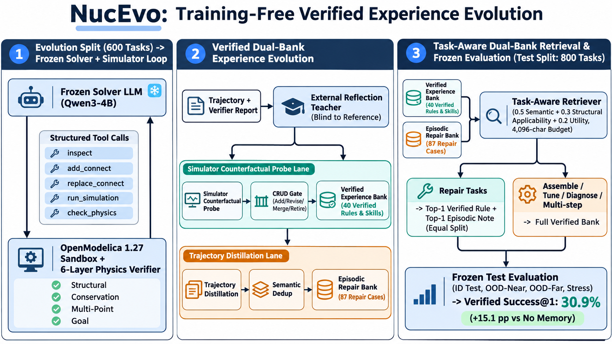
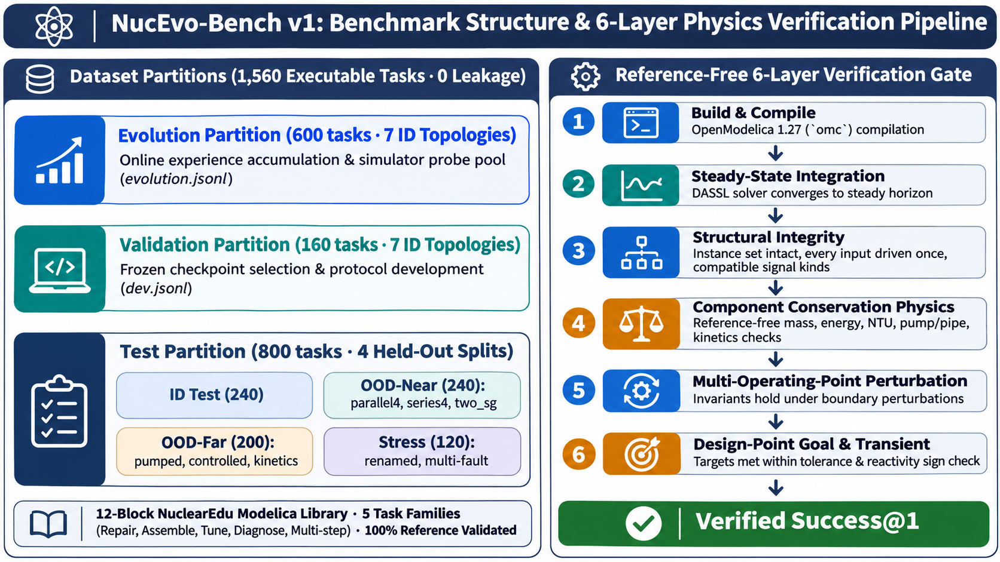

<div align="center">

# NucEvo

**Training-Free Verified Experience Evolution for Nuclear Thermal-Hydraulic Modeling Agents**

[](https://www.python.org/)
[](https://openmodelica.org/)
[-1E3A5F)](docs/BENCHMARK.md)
[](LICENSE)

*A frozen LLM solver that improves solely by evolving simulator-verified external experience—paired with **NucEvo-Bench v1**, an executable OpenModelica benchmark with reference-free physics verification.*

[Architecture](#architecture) • [Official Results](#official-results) • [NucEvo-Bench v1](#nucevo-bench-v1) • [Quick Start](#quick-start) • [Documentation](#documentation)

</div>

---

## Overview

**NucEvo** studies **training-free recursive experience improvement** in executable engineering modeling. Model weights (`Qwen3-4B-Instruct-2507`), retrieval embeddings (`BAAI/bge-small-en-v1.5`), and the OpenModelica simulator remain completely frozen. All performance gains come from evolving, verifying, and retrieving structured external engineering experience:

- **Simulator-Grounded Verification**: Candidate engineering rules proposed by an external reflection teacher (blind to ground-truth references) are compiled and tested via **counterfactual rewiring probes** in real OpenModelica 1.27 before entering the verified memory bank.
- **Dual-Bank Experience Architecture**: Combines a compact **Verified Experience Bank** (40 simulator-verified rules, invariants, and assembly skills) with a complementary **Episodic Repair Bank** (87 trajectory-distilled repair cases) under a strict **4,096-character** memory budget.
- **Task-Aware Retrieval Policy**: Dynamically scores candidate memories by semantic similarity (`0.5`), observable structural applicability (`0.3`), and historical transfer utility (`0.2`). On `repair` tasks, NucEvo pairs the top-1 verified rule with the top-1 complementary episodic repair note (equal character split); on `assemble`, `tune`, `diagnose`, and `multistep` tasks, it deploys full verified-bank retrieval.
- **Fixed, Leakage-Free Benchmark (`NucEvo-Bench v1`)**: 1,560 executable tasks partitioned cleanly into **Evolution (600)**, **Validation (160)**, and **Test (800)** sets across 15 composable topologies, 5 task families, and 4 difficulty tiers, scored by a **6-layer reference-free physics verifier**.

---

## Architecture



### End-to-End Workflow

1. **Interactive Modeling Loop (`nucevo/solver/`)**: The frozen solver operates inside a stateful OpenModelica sandbox (`TaskEnv`) with 13 structured tools (`inspect`, `read_file`, `edit_file`, `write_file`, `add_connect`, `replace_connect`, `remove_connect`, `set_parameter`, `run_simulation`, `check_physics`, `compare_to_targets`, `diagnose`, `submit`) and a robust tool-call parser supporting both nested `args`/`arguments` and flat JSON fields.
2. **Dual-Bank Experience Evolution (`nucevo/evolution/`, `nucevo/memory/`, `nucevo/teacher/`)**:
   - Episodes run in parallel batches (`batch=6`) on the **Evolution** partition (`seed=11`, `120` tasks).
   - An external reflection teacher inspects only observable trajectories and verifier failure stages (never the reference model) to propose structured `MemoryItem` records (`rule`, `failure`, `skill`, `success`).
   - **Verified Bank** (`assets/banks/verified_bank.json`): Every `rule` undergoes multi-point + counterfactual OpenModelica probing (`nucevo/memory/verifier.py`), followed by versioned event-sourced CRUD (`add`, `revise`, `merge`, `retire`) and negative-transfer retirement.
   - **Episodic Bank** (`assets/banks/episodic_bank.json`): Captures broad trajectory repair lessons with semantic deduplication (`cosine > 0.93`).
3. **Task-Aware Retrieval & Frozen Evaluation (`nucevo/memory/retriever.py`, `nucevo/evaluation/`)**:
   - Evaluation freezes both banks—no test/validation feedback ever mutates memory or usage statistics.
   - Retrieval queries use only observable task metadata (`instruction`, `family`, `template`, component multiset).
   - Identical `(task_id, prompt_sha256)` pairs are deduplicated on disk with atomic checkpoints for deterministic, resumable multi-GPU runs.

---

## Official Results

Evaluated on the complete **NucEvo-Bench v1 Test Partition (800 tasks)** using frozen `Qwen3-4B-Instruct-2507` (greedy decoding, `temperature=0`, `seed=0`, `max_tokens=700`), frozen `BAAI/bge-small-en-v1.5`, OpenModelica `1.27.1`, and a uniform **4,096-character** memory budget (5,600 logical method–task evaluations; 3,842 distinct deduplicated episodes).


### Main Table — Test Splits (`Verified Success@1`)

| Method | All Test (800) | ID Test (240) | OOD-Near (240) | OOD-Far (200) | Stress (120) |
| :--- | :---: | :---: | :---: | :---: | :---: |
| No Memory | 126/800 (15.8%) | 49/240 (20.4%) | 47/240 (19.6%) | 21/200 (10.5%) | 9/120 (7.5%) |
| Generic Engineering Guide | 120/800 (15.0%) | 53/240 (22.1%) | 47/240 (19.6%) | 13/200 (6.5%) | 7/120 (5.8%) |
| ReasoningBank (Adapted) | 177/800 (22.1%) | 85/240 (35.4%) | 52/240 (21.7%) | 30/200 (15.0%) | **10/120 (8.3%)** |
| NucEvo (Verified-Only) | 202/800 (25.2%) | 106/240 (44.2%) | 59/240 (24.6%) | 29/200 (14.5%) | 8/120 (6.7%) |
| **NucEvo (Full)** | **247/800 (30.9%)** | **125/240 (52.1%)** | **76/240 (31.7%)** | **36/200 (18.0%)** | **10/120 (8.3%)** |

> **Paired Statistical Significance (Exact Two-Sided McNemar, N = 800)**:
> - **NucEvo (Full) vs. No Memory**: `+15.1 pp` (150 unique wins vs. 29 losses, $p = 3.6 \times 10^{-21}$)
> - **NucEvo (Full) vs. ReasoningBank**: `+8.8 pp` (118 unique wins vs. 48 losses, $p = 5.5 \times 10^{-8}$)
> - **NucEvo (Full) vs. Verified-Only**: `+5.6 pp` (70 unique wins vs. 25 losses, $p = 4.4 \times 10^{-6}$)

### Breakdown by Difficulty Tier & Key Task Families

| Subset | Tasks | No Memory | ReasoningBank | Verified-Only | **NucEvo (Full)** |
| :--- | :---: | :---: | :---: | :---: | :---: |
| Easy | 60 | 23.3% | 40.0% | 71.7% | **78.3%** |
| Medium | 203 | 15.3% | 20.2% | 27.1% | **33.5%** |
| Hard | 352 | 15.6% | 24.4% | 25.0% | **31.8%** |
| Challenge | 185 | 14.1% | **14.1%** | 8.6% | 10.8% |
| Repair | 321 | 30.5% | 40.5% | 28.3% | **42.4%** |
| Assemble | 275 | 0.4% | 2.5% | **31.3%** | **31.3%** |

Full CSV and JSON artifacts are versioned in [`results/`](results/).

---

## NucEvo-Bench v1



All 1,560 tasks are built on the bundled 12-block lumped thermal-hydraulics library [`NuclearEdu.mo`](nucevo/benchmark/nuclear_edu/NuclearEdu.mo), deduplicated globally by structural/task signature, and 100% validated against the full 6-layer verifier (`data/MANIFEST.json`).

| Partition | Split | Tasks | Topologies | Role |
| :--- | :--- | :---: | :--- | :--- |
| **Evolution** | `data/evolution/evolution.jsonl` | **600** | 7 ID templates (`single`, `loop`, `series2/3`, `parallel2/3`, `sensor_loop`) | Experience accumulation & simulator probe pool |
| **Validation** | `data/validation/dev.jsonl` | **160** | 7 ID templates | Frozen checkpoint & protocol development |
| **Test** | `data/test/id_test.jsonl` | **240** | 7 ID templates | Held-out in-distribution evaluation |
| **Test** | `data/test/ood_near.jsonl` | **240** | `parallel4`, `series4`, `two_sg` | Compositional generalization (seen blocks, new topologies) |
| **Test** | `data/test/ood_far.jsonl` | **200** | `pumped`, `controlled`, `pumped_controlled`, `kinetics`, `kinetics_pumped` | Unseen physical component types |
| **Test** | `data/test/stress.jsonl` | **120** | Renamed instances, multi-fault stress cases | Robustness & negative-transfer probe |

---

## Repository Structure

```text
NucEvo/
├── nucevo/                          # Core Python package
│   ├── config.py                    # Centralized paths & environment resolution
│   ├── benchmark/                   # NucEvo-Bench v1 engine
│   │   ├── nuclear_edu/NuclearEdu.mo# 12-block causal Modelica component library
│   │   ├── simulator.py             # Self-contained OpenModelica 1.27 driver + cache
│   │   ├── loader.py                # Evolution / Validation / Test loader & SHA-1 audit
│   │   ├── generators/              # Deterministic topology & task generators
│   │   └── verifier/                # 6-layer reference-free physics verifier (v3 + phys)
│   ├── memory/                      # Dual-bank memory subsystem
│   │   ├── schema.py                # Structured MemoryItem dataclass & prompt renderer
│   │   ├── bank.py                  # Event-sourced versioned MemoryBank (CRUD + snapshots)
│   │   ├── verifier.py              # Counterfactual & multi-point simulator probe verifier
│   │   └── retriever.py             # Multi-factor Retriever & task-aware NucEvoRetriever
│   ├── solver/                      # Frozen solver runtime
│   │   ├── client.py                # OpenAI-compatible vLLM client + token accounting
│   │   ├── parser.py                # Robust tool-call parser (nested & flat JSON)
│   │   ├── env.py                   # Interactive 13-tool OpenModelica TaskEnv
│   │   └── agent.py                 # Bounded-context episode loop & step budgets
│   ├── teacher/                     # External reflection teacher (blind to reference)
│   │   ├── client.py                # Cached OpenAI-compatible teacher client
│   │   └── prompts.py               # Reflection prompts & anti-vagueness schema gate
│   ├── evolution/                   # Online training-free evolution loop
│   │   └── runner.py                # Batch rollout -> reflect -> probe -> CRUD -> snapshot
│   └── evaluation/                  # Frozen evaluation harness
│       ├── runner.py                # SHA-256 prompt-deduped, resumable evaluator
│       └── metrics.py               # Stratified tables & exact two-sided McNemar test
├── data/                            # Frozen NucEvo-Bench v1 dataset (1,560 tasks)
│   ├── MANIFEST.json                # Pinned SHA-1 hashes & split metadata
│   ├── benchmark_difficulty.json    # Structural difficulty tier labels (Easy..Challenge)
│   ├── evolution/evolution.jsonl    # Evolution partition (600)
│   ├── validation/dev.jsonl         # Validation partition (160)
│   └── test/                        # Test partition (800: id_test, ood_near, ood_far, stress)
├── assets/banks/                    # Pre-evolved official frozen experience banks
│   ├── verified_bank.json           # 40 simulator-verified rules/failures/skills
│   └── episodic_bank.json           # 87 trajectory-distilled episodic notes
├── configs/                         # Reproducible JSON experiment configs
├── results/                         # Official 800-task CSV & JSON benchmark results
├── scripts/                         # Entrypoints: verify_benchmark, serve_vllm, evolve, evaluate
├── docs/                            # Contributor guides & visual assets
└── tests/                           # Offline unit & integrity test suite
```

---

## Quick Start

### 1. Install & Verify Benchmark Integrity (No GPU Required)

```bash
git clone https://github.com/TreeEast1/NucEvo.git
cd NucEvo
pip install -r requirements.txt

# Verify dataset SHA-1 hashes, zero cross-split leakage, and unit tests
python scripts/verify_benchmark.py
python -m unittest discover -s tests -v
```

### 2. Configure OpenModelica & Solver Service

Install OpenModelica `>= 1.27` (e.g., via conda-forge `openmodelica`) and configure environment variables from [`.env.example`](.env.example):

```bash
export NUCEVO_OMC=/path/to/om/bin/omc
export OPENMODELICALIBRARY=/path/to/omlibrary
export OMP_NUM_THREADS=2

# Launch frozen Qwen3-4B solver replicas (1 GPU per port)
MODEL=/path/to/Qwen3-4B-Instruct-2507 GPUS=0,1,2,3 BASE_PORT=8011 bash scripts/serve_vllm.sh
```

### 3. Evaluate Pre-Evolved NucEvo on Validation or Test Splits

```bash
# Quick check: NucEvo on the 160-task validation partition
python scripts/evaluate.py --partition validation --policies nucevo --ports 8011,8012,8013,8014 --out runs/eval_val

# Full official reproduction: all 800 test tasks × 7 policies
python scripts/evaluate.py --config configs/eval_benchmark_v1.json --out runs/eval_test_v1
```

### 4. Run Training-Free Evolution from Scratch (Optional)

Set `NUCEVO_TEACHER_BASE_URL`, `NUCEVO_TEACHER_API_KEY`, and `NUCEVO_TEACHER_MODEL` in `.env`, then evolve both banks on the 600-task `evolution` partition:

```bash
# 1) Evolve the simulator-verified rule & skill bank
python scripts/evolve.py --config configs/evolution_verified.json --out runs/evolve_verified

# 2) Evolve the complementary episodic repair bank
python scripts/evolve.py --config configs/evolution_episodic.json --out runs/evolve_episodic
```

---

## Key Configuration Reference

| Parameter | Official Value | Where Configured |
| :--- | :--- | :--- |
| Solver Model | `Qwen3-4B-Instruct-2507` (frozen) | `configs/nucevo_default.json` |
| Solver Decoding | `temperature=0.0`, `top_p=1.0`, `seed=0`, `max_tokens=700`, `stop=["</tool_call>"]` | `nucevo/solver/client.py` |
| Step Budgets | `repair/tune/diagnose: 16`, `multistep: 22`, `assemble: min(30, 10 + n_connects)` | `nucevo/solver/agent.py` |
| Embedding Encoder | `BAAI/bge-small-en-v1.5` (frozen, mean-pooled + L2-normalized) | `nucevo/memory/retriever.py` |
| Retrieval Weights | `0.5 * semantic + 0.3 * applicability + 0.2 * utility` | `nucevo/memory/retriever.py` |
| Memory Budget | `4,096` characters (`~1,024` tokens); repair pairs split `(4096 - 2) // 2` each | `nucevo/memory/retriever.py` |
| Evolution Stream | `120` shuffled evolution tasks (`seed=11`), batch `6`, `novel_only=true`, probe pool `80` | `configs/evolution_*.json` |
| Simulator | OpenModelica `1.27.1`, DASSL (`tol=1e-6`, `stop=1200s`, `intervals=600`) | `nucevo/benchmark/simulator.py` |

---

## Documentation

- **[`docs/ARCHITECTURE.md`](docs/ARCHITECTURE.md)** — Detailed code walkthrough of every module, data schema, retrieval math, and extension points for contributors.
- **[`docs/BENCHMARK.md`](docs/BENCHMARK.md)** — Complete specification of **NucEvo-Bench v1** (partitions, component library, 15 topologies, difficulty tiers, 6-layer verification, and leaderboard protocol).
- **[`docs/REPRODUCE.md`](docs/REPRODUCE.md)** — Step-by-step reproduction checklist, environment setup, GPU sizing, resumption, and troubleshooting.

---

## Scope & Safety Notice

`NuclearEdu.mo` is a lumped-parameter, single-phase **educational** Modelica library created for controlled AI research. It is **not** a qualified nuclear thermal-hydraulics code (such as RELAP5 or TRACE) and must never be used for real plant design, licensing, or safety validation.
