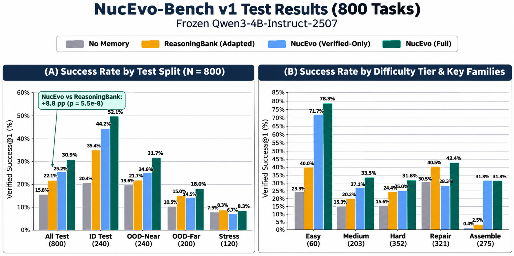

<div align="center">

# NucEvo

**面向核工程热工水力建模智能体的免训练可验证经验进化框架**

[](https://www.python.org/)
[](https://openmodelica.org/)
[-1E3A5F)](docs/BENCHMARK.md)
[](LICENSE)

*在完全冻结模型权重的前提下，通过仿真验证与外部经验演化持续提升可执行工程建模能力，并开源配套基准 **NucEvo-Bench v1**。*

**简体中文** | [English](README_EN.md)

[核心架构](#核心架构) • [官方测评结果](#官方测评结果) • [NucEvo-Bench v1 基准](#nucevo-bench-v1-基准) • [快速开始](#快速开始) • [开发文档](#开发文档)

</div>

---

## 项目简介

**NucEvo** 面向可执行核热工水力 Modelica 建模任务，研究**免训练经验自进化（Training-Free Experience Evolution）**。整个流程中，求解器模型权重（`Qwen3-4B-Instruct-2507`）、检索编码器（`BAAI/bge-small-en-v1.5`）与 OpenModelica 仿真器均完全冻结，所有性能提升均来自对外部结构化工程经验的演化、验证与检索：

- **仿真驱动的反事实核验**：外部反思教师对标准答案完全不可见，仅依据轨迹与校验报告提出候选经验；所有物理/连接规则必须先通过真实 OpenModelica 1.27 的**多工况 + 反事实重连探针**检验，才能进入已验证经验库。
- **双库协同经验架构**：在同一套进化任务流上构建两套互补的经验库——高精度的**已验证经验库（Verified Bank，40 条）**沉淀可迁移物理规则与装配技能，宽覆盖的**情景修复库（Episodic Bank，87 条）**保留丰富的故障定位与修复线索，统一受限于 **4,096 字符**记忆预算。
- **任务感知检索策略**：综合语义相似度（`0.5`）、可观测结构适用度（`0.3`）与历史正负迁移效用（`0.2`）进行排序。在 `repair` 修复类任务上，NucEvo 等分预算拼接 Top-1 已验证规则与 Top-1 情景修复案例；在 `assemble`、`tune`、`diagnose`、`multistep` 任务上采用完整已验证库检索。
- **固定、无泄漏的开源基准（NucEvo-Bench v1）**：包含 **1,560** 道可执行 OpenModelica 任务，明确划分为**进化集（600）**、**验证集（160）**与**测试集（800）**，覆盖 15 种组合拓扑、5 类任务族与 4 个结构难度档，由**6 层无参考物理校验器**严格打分。

---

## 核心架构


### 端到端流程

1. **交互式建模沙盒（`nucevo/solver/`）**：冻结求解器在有状态的 OpenModelica 环境（`TaskEnv`）中通过 13 个结构化工具完成检查、编辑与仿真（`inspect`、`read_file`、`edit_file`、`write_file`、`add_connect`、`replace_connect`、`remove_connect`、`set_parameter`、`run_simulation`、`check_physics`、`compare_to_targets`、`diagnose`、`submit`），内置兼容嵌套 `args`/`arguments` 与扁平 JSON 参数的鲁棒工具解析器。
2. **双库免训练进化（`nucevo/evolution/`、`nucevo/memory/`、`nucevo/teacher/`）**：
   - 在**进化集**上按固定随机序（`seed=11`，前 120 题，并行批次 `batch=6`）执行轨迹采集与经验反思。
   - 外部反思教师不接触任何参考答案，仅根据轨迹日志与分层校验结果输出结构化 `MemoryItem`（`rule` / `failure` / `skill` / `success`），并经过去空泛化校验。
   - **已验证经验库**（`assets/banks/verified_bank.json`）：对规则执行 OpenModelica 多点及反事实重连探测（`nucevo/memory/verifier.py`），并支持事件溯源版本化 CRUD（`add` / `revise` / `merge` / `retire`）与负迁移自动淘汰。
   - **情景修复库**（`assets/banks/episodic_bank.json`）：蒸馏轨迹级排障修复经验，并通过语义去重（`cosine > 0.93`）控制冗余。
3. **任务感知检索与冻结评测（`nucevo/memory/retriever.py`、`nucevo/evaluation/`）**：
   - 验证与测试阶段完全冻结经验库，不回写任何使用统计或反馈，严格杜绝数据泄漏。
   - 检索仅使用可观测任务元信息（指令、任务族、模板与组件类型集合）。
   - 评测器按 `(task_id, prompt_sha256)` 自动去重并原子落盘，支持多卡并发与断点续跑。

---

## 官方测评结果

以下为 **NucEvo-Bench v1 完整测试集（800 题）**的官方基线与主表结果：冻结求解器 `Qwen3-4B-Instruct-2507`（贪心解码 `temperature=0`、`seed=0`、`max_tokens=700`）、冻结检索编码器 `BAAI/bge-small-en-v1.5`、OpenModelica `1.27.1`，统一 **4,096 字符**记忆预算（共 5,600 项方法–题目逻辑得分，去重后 3,842 条独立仿真轨迹）。



### 主表 — 按测试集划分（`Verified Success@1`）

| 方法 | 全部测试集 (800) | ID Test (240) | OOD-Near (240) | OOD-Far (200) | Stress (120) |
| :--- | :---: | :---: | :---: | :---: | :---: |
| No Memory（无记忆） | 126/800 (15.8%) | 49/240 (20.4%) | 47/240 (19.6%) | 21/200 (10.5%) | 9/120 (7.5%) |
| Generic Guide（通用工程指南） | 120/800 (15.0%) | 53/240 (22.1%) | 47/240 (19.6%) | 13/200 (6.5%) | 7/120 (5.8%) |
| ReasoningBank（任务适配版） | 177/800 (22.1%) | 85/240 (35.4%) | 52/240 (21.7%) | 30/200 (15.0%) | **10/120 (8.3%)** |
| NucEvo（仅验证库） | 202/800 (25.2%) | 106/240 (44.2%) | 59/240 (24.6%) | 29/200 (14.5%) | 8/120 (6.7%) |
| **NucEvo（完整版）** | **247/800 (30.9%)** | **125/240 (52.1%)** | **76/240 (31.7%)** | **36/200 (18.0%)** | **10/120 (8.3%)** |

> **配对显著性检验（双侧精确 McNemar，N = 800）**：
> - **NucEvo（完整版）vs. 无记忆**：`+15.1 pp`（独赢 150 vs. 独负 29，$p = 3.6 \times 10^{-21}$）
> - **NucEvo（完整版）vs. ReasoningBank**：`+8.8 pp`（独赢 118 vs. 独负 48，$p = 5.5 \times 10^{-8}$）
> - **NucEvo（完整版）vs. 仅验证库**：`+5.6 pp`（独赢 70 vs. 独负 25，$p = 4.4 \times 10^{-6}$）

### 按难度分档与核心任务族拆分

| 子集 | 题数 | No Memory | ReasoningBank | NucEvo（仅验证库） | **NucEvo（完整版）** |
| :--- | :---: | :---: | :---: | :---: | :---: |
| Easy | 60 | 23.3% | 40.0% | 71.7% | **78.3%** |
| Medium | 203 | 15.3% | 20.2% | 27.1% | **33.5%** |
| Hard | 352 | 15.6% | 24.4% | 25.0% | **31.8%** |
| Challenge | 185 | 14.1% | **14.1%** | 8.6% | 10.8% |
| Repair（故障修复） | 321 | 30.5% | 40.5% | 28.3% | **42.4%** |
| Assemble（从零装配） | 275 | 0.4% | 2.5% | **31.3%** | **31.3%** |

完整官方 CSV 表格与 JSON 汇总指标见 [`results/`](results/)。

---

## NucEvo-Bench v1 基准


基准全部 1,560 道任务基于内置的 12 模块集总参数热工水力库 [`NuclearEdu.mo`](nucevo/benchmark/nuclear_edu/NuclearEdu.mo) 构建，全局按签名去重（0 跨划分重复），参考模型 100% 通过完整 6 层校验，所有文件 SHA-1 锁定于 [`data/MANIFEST.json`](data/MANIFEST.json)。

| 划分（Partition） | 数据文件 | 题数 | 拓扑范围 | 用途 |
| :--- | :--- | :---: | :--- | :--- |
| **进化集（Evolution）** | `data/evolution/evolution.jsonl` | **600** | 7 种分布内模板（`single`、`loop`、`series2/3`、`parallel2/3`、`sensor_loop`） | 在线经验进化与仿真探针验证池 |
| **验证集（Validation）** | `data/validation/dev.jsonl` | **160** | 7 种分布内模板 | 冻结检查点筛选、超参与消融开发 |
| **测试集 — ID Test** | `data/test/id_test.jsonl` | **240** | 7 种分布内模板 | 独立同分布留出测试 |
| **测试集 — OOD-Near** | `data/test/ood_near.jsonl` | **240** | `parallel4`、`series4`、`two_sg` | 组合外推测试（已知组件、全新拓扑） |
| **测试集 — OOD-Far** | `data/test/ood_far.jsonl` | **200** | `pumped`、`controlled`、`pumped_controlled`、`kinetics`、`kinetics_pumped` | 未见物理组件类型泛化边界测试 |
| **测试集 — Stress** | `data/test/stress.jsonl` | **120** | 组件重命名、复合多故障压力场景 | 鲁棒性与负迁移压力测试 |

---

## 代码目录结构

```text
NucEvo/
├── nucevo/                          # 核心 Python 代码包
│   ├── config.py                    # 统一路径、缓存与环境配置
│   ├── benchmark/                   # NucEvo-Bench v1 基准与仿真引擎
│   │   ├── nuclear_edu/NuclearEdu.mo# 12 模块因果型 Modelica 核热工组件库
│   │   ├── simulator.py             # 自包含 OpenModelica 1.27 驱动与内容缓存
│   │   ├── loader.py                # 进化集/验证集/测试集加载与 SHA-1 完整性校验
│   │   ├── generators/              # 确定性拓扑与任务生成器
│   │   └── verifier/                # 6 层无参考物理校验器（v3 + phys）
│   ├── memory/                      # 双库记忆、核验与检索子系统
│   │   ├── schema.py                # 结构化 MemoryItem 数据结构与提示词渲染
│   │   ├── bank.py                  # 事件溯源版本化 MemoryBank（CRUD + 不可变快照）
│   │   ├── verifier.py              # 多点与反事实 OpenModelica 探针核验器
│   │   └── retriever.py             # 多因子检索器与任务感知双库 NucEvoRetriever
│   ├── solver/                      # 冻结求解器运行环境
│   │   ├── client.py                # OpenAI 兼容 vLLM 客户端与 Token 统计
│   │   ├── parser.py                # 鲁棒工具解析器（兼容嵌套 args 与扁平字段）
│   │   ├── env.py                   # 13 工具交互式 OpenModelica 沙盒（TaskEnv）
│   │   └── agent.py                 # 有界上下文多步回合主循环与步数预算
│   ├── teacher/                     # 外部反思教师（盲参考）
│   │   ├── client.py                # 带磁盘缓存的 OpenAI 兼容教师接口
│   │   └── prompts.py               # 反思提示词模板与反空泛经验过滤门控
│   ├── evolution/                   # 免训练在线经验进化主循环
│   │   └── runner.py                # 批次采样 -> 反思 -> 仿真探针 -> CRUD -> 快照
│   └── evaluation/                  # 冻结评测与配对统计框架
│       ├── runner.py                # SHA-256 提示词去重、原子断点续跑评测器
│       └── metrics.py               # 分层汇总与双侧精确 McNemar 检验
├── data/                            # 固定版 NucEvo-Bench v1 数据集（1,560 题）
│   ├── MANIFEST.json                # 锁定全部划分 SHA-1 与元信息
│   ├── benchmark_difficulty.json    # 4 档结构难度标注（Easy..Challenge）
│   ├── evolution/evolution.jsonl    # 进化集（600）
│   ├── validation/dev.jsonl         # 验证集（160）
│   └── test/                        # 测试集（800：id_test / ood_near / ood_far / stress）
├── assets/banks/                    # 官方预演化冻结双经验库
│   ├── verified_bank.json           # 已验证经验库（40 条）
│   └── episodic_bank.json           # 情景修复库（87 条）
├── configs/                         # 标准化 JSON 实验配置
├── results/                         # 官方 800 题测试集 CSV/JSON 结果沉淀
├── scripts/                         # 命令行入口：verify_benchmark / serve_vllm / evolve / evaluate
├── docs/                            # 协作者架构指南、基准规范、复现手册与配图
└── tests/                           # 离线完整性与核心逻辑单元测试
```

---

## 快速开始

### 1. 安装依赖并校验基准完整性（无需 GPU）

```bash
git clone https://github.com/TreeEast1/NucEvo.git
cd NucEvo
pip install -r requirements.txt

# 校验 1,560 道任务 SHA-1、0 跨划分泄漏以及 12 项单元测试
python scripts/verify_benchmark.py
python -m unittest discover -s tests -v
```

### 2. 配置 OpenModelica 与冻结求解器服务

安装 OpenModelica `>= 1.27`（如通过 conda-forge 安装 `openmodelica`），参考 [`.env.example`](.env.example) 配置环境变量并启动 vLLM 求解器：

```bash
export NUCEVO_OMC=/path/to/om/bin/omc
export OPENMODELICALIBRARY=/path/to/omlibrary
export OMP_NUM_THREADS=2

# 每卡启动一个冻结的 Qwen3-4B 求解器副本
MODEL=/path/to/Qwen3-4B-Instruct-2507 GPUS=0,1,2,3 BASE_PORT=8011 bash scripts/serve_vllm.sh
```

### 3. 直接使用预演化经验库跑验证集或测试集

```bash
# 快速在 160 题验证集上评测 NucEvo
python scripts/evaluate.py --partition validation --policies nucevo --ports 8011,8012,8013,8014 --out runs/eval_val

# 完整复现 800 题测试集 × 7 组对照的官方主表
python scripts/evaluate.py --config configs/eval_benchmark_v1.json --out runs/eval_test_v1
```

### 4. 从零复现双库免训练进化（可选）

在 `.env` 中填入反思教师的 `NUCEVO_TEACHER_BASE_URL`、`NUCEVO_TEACHER_API_KEY` 与 `NUCEVO_TEACHER_MODEL`，在进化集上分别演化两套经验库：

```bash
# 1) 演化仿真核验的已验证经验库
python scripts/evolve.py --config configs/evolution_verified.json --out runs/evolve_verified

# 2) 演化情景修复经验库
python scripts/evolve.py --config configs/evolution_episodic.json --out runs/evolve_episodic
```

---

## 核心配置速查

| 配置项 | 官方默认参数 | 定义位置 |
| :--- | :--- | :--- |
| 求解器模型 | `Qwen3-4B-Instruct-2507`（完全冻结） | `configs/nucevo_default.json` |
| 解码参数 | `temperature=0.0`, `top_p=1.0`, `seed=0`, `max_tokens=700`, `stop=["</tool_call>"]` | `nucevo/solver/client.py` |
| 回合步数上限 | `repair/tune/diagnose: 16`, `multistep: 22`, `assemble: min(30, 10 + n_connects)` | `nucevo/solver/agent.py` |
| 检索编码器 | `BAAI/bge-small-en-v1.5`（冻结，mean pooling + L2 归一化） | `nucevo/memory/retriever.py` |
| 检索打分权重 | `0.5 × 语义相似度 + 0.3 × 结构适用度 + 0.2 × 历史效用` | `nucevo/memory/retriever.py` |
| 记忆字符预算 | `4,096` 字符（约 1,024 tokens）；`repair` 双笔记对按 `(4096 - 2) // 2` 等分 | `nucevo/memory/retriever.py` |
| 进化任务流 | `evolution` 前 120 题随机序（`seed=11`），批次 `6`，`novel_only=true`，探针池 `80` 题 | `configs/evolution_*.json` |
| 仿真配置 | OpenModelica `1.27.1`，DASSL（`tol=1e-6`，`stop=1200s`，`intervals=600`） | `nucevo/benchmark/simulator.py` |

---

## 开发文档

- **[`docs/ARCHITECTURE.md`](docs/ARCHITECTURE.md)** — 模块级代码逻辑拆解、数据结构、检索数学公式与二次开发扩展点。
- **[`docs/BENCHMARK.md`](docs/BENCHMARK.md)** — **NucEvo-Bench v1** 完整技术规范（进化/验证/测试划分、12 模块库、15 种拓扑、6 层校验与官方榜单）。
- **[`docs/REPRODUCE.md`](docs/REPRODUCE.md)** — 环境搭建、GPU 资源配置、断点续跑与端到端复现清单。
- **[`README_EN.md`](README_EN.md)** — English version of this README.

---

## 适用范围与安全声明

`NuclearEdu.mo` 是面向 AI 科研评测构建的集总参数、单相**教育型** Modelica 组件库，**并非**经过核安全审评认证的工业级热工水力程序（如 RELAP5、TRACE），不可用于真实核电厂设计、安全分析或工程许可。
