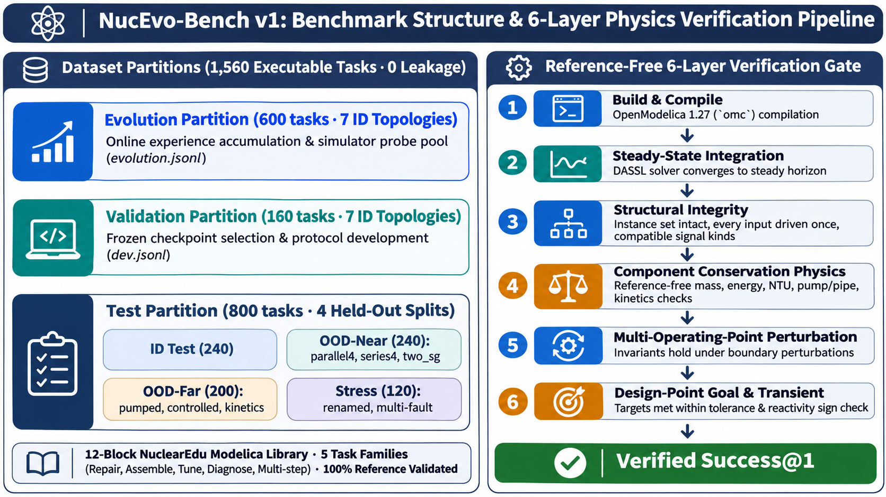

# NucEvo-Bench v1 Specification

**NucEvo-Bench v1** is a frozen, executable, physics-verified benchmark of **1,560** nuclear thermal-hydraulic modeling tasks built on OpenModelica 1.27 and the 12-block `NuclearEdu.mo` library.

---

## 1. Benchmark Partitions (Zero Cross-Split Leakage)

All 1,560 tasks are generated with global structural and content signature deduplication (`1,560` unique IDs, `1,560` unique signatures, `100%` reference validation pass rate). Every file hash is pinned in [`data/MANIFEST.json`](../data/MANIFEST.json).

| Partition | File | Tasks | Topologies | Intended Use |
| :--- | :--- | :---: | :--- | :--- |
| **Evolution** | `data/evolution/evolution.jsonl` | 600 | 7 ID templates | Online experience accumulation & simulator probe pool |
| **Validation** | `data/validation/dev.jsonl` | 160 | 7 ID templates | Checkpoint selection, hyperparameter tuning, ablations |
| **Test — ID** | `data/test/id_test.jsonl` | 240 | 7 ID templates | Held-out in-distribution test |
| **Test — OOD-Near** | `data/test/ood_near.jsonl` | 240 | `parallel4`, `series4`, `two_sg` | Compositional generalization (familiar blocks, new layouts) |
| **Test — OOD-Far** | `data/test/ood_far.jsonl` | 200 | `pumped`, `controlled`, `pumped_controlled`, `kinetics`, `kinetics_pumped` | Generalization to unseen physical blocks |
| **Test — Stress** | `data/test/stress.jsonl` | 120 | Mixed renamed instances & multi-fault tasks | Robustness & negative-transfer testing |

> **Anti-Leakage Protocol**: Evolution, teacher reflection, and simulator probe contexts are strictly restricted to the **Evolution** partition. **Validation** and **Test** evaluations must always run against frozen memory snapshots with usage updates disabled.

---

## 2. Component Library (`NuclearEdu.mo`)

Located at `nucevo/benchmark/nuclear_edu/NuclearEdu.mo` (SHA-1: `5e53620ed24c698f214b98f2e0a7b129c0eadb61`), the library contains 12 causal blocks sharing a single `Sig` connector (`Real u`):

- **Thermal & Heat Transfer**: `PowerSource`, `FuelPin`, `Channel`, `SteamGenerator`
- **Flow Routing & Hydraulics**: `Mixer`, `Splitter`, `Pump`, `Pipe`
- **Reactivity, Controls & Sources**: `PointKinetics`, `Controller`, `Sensor`, `Const`

Because all connectors share the same Modelica type, physically incorrect wiring still compiles cleanly—making compilability and physical validity distinct signals.

---

## 3. Task Families & Structural Difficulty Tiers

### Five Task Families (Test Partition, N = 800)

| Family | Count | Description |
| :--- | :---: | :--- |
| `repair` | 321 | Diagnose and fix swapped, misrouted, missing, or misparameterized faults in an existing plant model. |
| `assemble` | 275 | Wire all component connections from a skeleton model to satisfy conservation and design targets. |
| `multistep` | 91 | Compound tasks combining structural repair and operating-point re-tuning. |
| `tune` | 74 | Adjust boundary or component parameters to achieve new steady-state targets. |
| `diagnose` | 39 | Identify the fault category (`swapped_connections`, `wrong_parameter`, `wrong_boundary_condition`, `wrong_routing`, `missing_connection`) and repair the plant. |

### Four Structural Difficulty Tiers (`data/benchmark_difficulty.json`)

| Tier | Test Count | Characteristics |
| :--- | :---: | :--- |
| `Easy` | 60 | Compact single-channel or small loops with low connection counts. |
| `Medium` | 203 | Multi-block series/parallel plants or single-fault repairs. |
| `Hard` | 352 | High fan-out manifolds (`parallel2/3`, `series3`, `controlled`) or coupled thermal-hydraulic repairs. |
| `Challenge` | 185 | Large compositional plants (`parallel4`, `series4`, `kinetics_pumped`) and multi-fault stress instances. |

---

## 4. Six-Layer Reference-Free Verification (`nucevo/benchmark/verifier/v3.py`)

A submission receives `Verified Success@1 = 1` if and only if it passes all six criteria (any physically valid wiring is accepted—never string-matched against a reference):

1. **Build & Compile**: Compiles cleanly with `omc`.
2. **Steady-State Integration**: Integrates with DASSL (`tol=1e-6`, `stopTime=1200s`) and reaches steady state.
3. **Structural Integrity**: Original component set preserved, zero unconnected inputs, each input driven once by an output of compatible signal kind.
4. **Component Conservation Physics**: Every block closes its own governing conservation law (mass balance, enthalpy balance, fuel-to-coolant temperature hierarchy, SG NTU equation, pump head-flow curve, pipe quadratic drop, controller bounds, kinetics equilibrium).
5. **Multi-Operating-Point Perturbation**: Conservation invariants continue to hold under boundary perturbations.
6. **Design-Point Goal & Transient**: Steady-state measurements match target values within relative/absolute tolerances; kinetics plants additionally pass reactivity step sign checks (`±500 pcm`).

---

## 5. Official Benchmark Leaderboard (Test Partition, N = 800)

Source: [`results/official_main_table.csv`](../results/official_main_table.csv), [`results/official_difficulty.csv`](../results/official_difficulty.csv), [`results/official_family.csv`](../results/official_family.csv), and [`results/official_summary.json`](../results/official_summary.json).

| Method | All (800) | ID Test (240) | OOD-Near (240) | OOD-Far (200) | Stress (120) |
| :--- | :---: | :---: | :---: | :---: | :---: |
| No Memory | 15.8% | 20.4% | 19.6% | 10.5% | 7.5% |
| Generic Guide | 15.0% | 22.1% | 19.6% | 6.5% | 5.8% |
| Ablation: Semantic Episodic on Repair | 17.8% | 26.2% | 17.5% | 14.0% | 7.5% |
| ReasoningBank (Adapted) | 22.1% | 35.4% | 21.7% | 15.0% | 8.3% |
| NucEvo (Verified-Only) | 25.2% | 44.2% | 24.6% | 14.5% | 6.7% |
| Ablation: Paired Verified Notes | 25.2% | 44.2% | 24.6% | 14.5% | 6.7% |
| **NucEvo (Full)** | **30.9%** | **52.1%** | **31.7%** | **18.0%** | **8.3%** |
